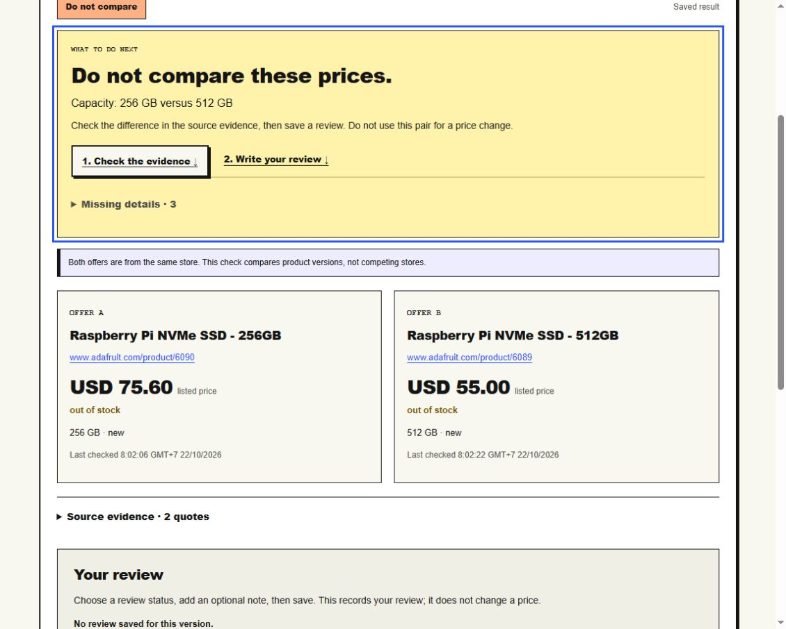
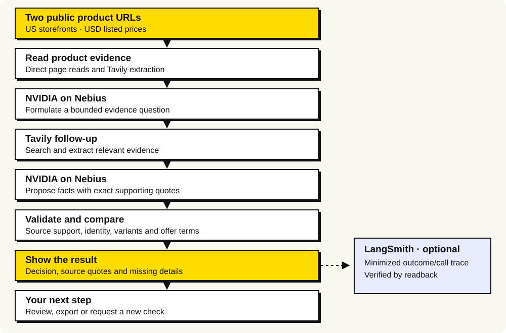

# ResolveSignal

**Check the offer behind a price alert before changing your price.**

ResolveSignal helps online sellers investigate whether two retail offers are actually comparable. A lower price may refer to a different capacity, a refurbished item, a multipack or a member-only offer. The app keeps the differences, missing facts, source quotes and your review together. It never changes a store price.

[Try the public demo](https://app.resolvesignal.com) · [Live configuration](docs/configuration.md) · [Troubleshooting](docs/troubleshooting.md)



*Actual application screenshot: a saved Adafruit 256 GB /512 GB comparison. Both offers are from the same store and were out of stock when checked. These are timestamped observations, not current prices or a competitor savings claim.*

## Try it without API keys

Use the [public demo](https://app.resolvesignal.com), or run a local copy below. A new local installation has no hosted results or customer data.

1. Open **Live check** in the public demo, or **New check** locally.
2. Choose **Try made-up examples**. This uses fictional offers and makes no live provider calls.
3. Open a result. Read **What to do next**, compare the offers and expand **Source evidence**.
4. Choose a review status, optionally add a note, then **Save review**. Reload to see that it persists.
5. Use **Download group** for CSV, JSON or an HTML report. **Run example again** creates a new version; the earlier review stays in history.

The public demo also has saved real investigations. Viewing them uses no new provider credits. New live checks use the shared allowance. Product links, results and reviews in the public demo are public; use public product information only.

## Check your own products

Choose **Check your products** on the homepage, paste two public HTTPS product-page links, select the exact size/color/version on each page, and choose **Run a new check**. Use US storefronts with USD prices. Any product type can be investigated; a readable page and sufficient evidence are still needed. The input is two URLs, not a product-name shopping search.

| Result | Meaning | Your next step |
|---|---|---|
| **Can compare** | Required product details and offer terms match on the listed-price basis. | Inspect the difference, stock and caveats, then save your review. |
| **Do not compare** | Supported evidence identifies a material difference. | Check the quoted difference; do not use this pair for a price change. |
| **More info needed** | Required facts are missing, stale or inconsistent. | Follow the recovery steps, inspect the sources or try different links. |

**Can compare** does not mean the cheaper item is available or that a price change is recommended. An out-of-stock offer can have comparable listed terms while the suggested action is to monitor availability. Shipping and tax may differ.

## Run locally

Prerequisites: **CPython 3.13**, Git and a browser with JavaScript enabled. Windows and Linux dependency locks are included. Node.js is only needed for the JavaScript tests; those tests were verified with Node.js 24.

```sh
git clone https://github.com/duclucky/app-resolvesignal.git
cd app-resolvesignal
```

### Windows PowerShell

```powershell
py -3.13 -m venv .venv
.venv/Scripts/python.exe -m pip install --require-hashes -r requirements.lock
.venv/Scripts/python.exe -m uvicorn src.main:app --host 127.0.0.1 --port 8000
```

### Linux

```sh
python3.13 -m venv .venv
.venv/bin/python -m pip install --require-hashes -r requirements.linux.lock
.venv/bin/python -m uvicorn src.main:app --host 127.0.0.1 --port 8000
```

Open [http://127.0.0.1:8000](http://127.0.0.1:8000), then follow **Try it without API keys** above. Stop the server with `Ctrl+C`. `run.ps1` is a Windows convenience launcher for an available Python 3.13 installation. Live calls are off by default; no `.env` file is needed for fictional examples.

For real agent investigations, follow [Live configuration](docs/configuration.md). Adding keys alone is insufficient: live calls must be enabled and **both usage caps must be greater than zero**. LangSmith tracing is optional. Public page inspection is also available locally without model/provider calls, but still makes network requests to the product pages.

## How the live agent works



[Editable Mermaid source](docs/workflow.mmd). The diagram is a static SVG so it remains readable without an external diagram renderer.

| Component | Job |
|---|---|
| **NVIDIA on Nebius Token Factory** | `nvidia/Nemotron-3.5-Super-VL` asks a bounded evidence question and proposes facts with exact quotes. |
| **Tavily** | Extracts permitted page text and searches for follow-up evidence. Search snippets are discovery leads, not verified merchant prices. |
| **Validation and comparison rules** | Check source support, identity, selected variants, condition, pack quantity, price terms, currency, availability and freshness. |
| **LangSmith, optional** | Records minimized outcomes, counters and provider summaries with readback verification. Page text, prompts, URLs, keys and review notes are excluded. |

Adafruit pages 6090/6089 are fetched directly under a specific rate policy rather than sent to remote extraction. Source text is evidence, never tool-execution authority. Failed optional tracing does not discard an investigation.

Built with FastAPI, Pydantic, Jinja, native JavaScript and SQLite. No React runtime or animation framework is required. Code, tests, fictional fixtures, helpers and documentation live under `src/`, `tests/`, `data/fixtures/`, `scripts/` and `docs/`.

## Evidence and limitations

- The [saved Adafruit result](https://app.resolvesignal.com/cases/27ef6e395a1e4142b4c69d19b7bf9f51) demonstrates a supported capacity mismatch, with actual Tavily/NVIDIA-on-Nebius calls and a verified LangSmith receipt. It is a same-store variant control.
- The [JBL/Harman investigation](https://app.resolvesignal.com/cases/7509de944ae44383a4adde38f0c71a64) demonstrates a real failure path. Both direct sources returned HTTP 403 in the checked recheck. Tavily/model calls ran, but no retailer claims passed validation on that attempt, so the result needs more information.
- SSDs and keyboards have category-specific checks. Other product types require matching validated GTIN/UPC/EAN barcodes plus the existing offer checks before a positive comparison. Matching titles or a store SKU are insufficient.
- Model-proposed barcodes need an exact labeled source span, a valid checksum and no competing labeled barcode in the supplied page evidence. JSON-LD and single-product microdata are supported; exact-variant evidence may still be missing.
- Sourced user confirmations can fill certain missing attributes with a source URL, excerpt and explicit attestation. They remain user-reported, cannot overwrite known contradictions and must be renewed after recheck. They cannot supply a barcode.
- Universal retailer access, a complete natural positive-price pair, customer adoption and measured seller time savings have not been established. A blocked page or unknown fact is not evidence of a match.

Saved results are observations at their displayed check times. The public demo has capped live usage; it is a hackathon demonstration, not an authenticated production workspace. See [Configuration and access limits](docs/configuration.md#usage-and-access-limits).

## Verification

The application release was checked on 22 October 2026 with **203 Python tests on Windows and Linux**, **11 JavaScript tests** and **37 fictional comparison scenarios**. Source publication was separately checked by manifest and isolated offline workflow. These checks do not establish natural retail accuracy or adoption. Pinned runtimes were reused; a fresh dependency installation or Dockerfile build is not claimed by that verification.

From the repository root, on Windows:

```powershell
New-Item -ItemType Directory -Force .cache | Out-Null
.venv/Scripts/python.exe -m pytest -q --basetemp .cache/readme-check-01
node --test tests/ui-state.test.cjs
.venv/Scripts/python.exe scripts/quality_eval.py --output .cache/local-quality.json
```

On Linux:

```sh
mkdir -p .cache
.venv/bin/python -m pytest -q --basetemp .cache/readme-check-01
node --test tests/ui-state.test.cjs
.venv/bin/python scripts/quality_eval.py --output .cache/local-quality.json
```

Create `.cache` before the first test run: pytest's `--basetemp` requires its parent directory to exist. Use a new `--basetemp` name on each run because pytest may clear that directory. Default tests use controlled providers and make no paid API calls; the quality command above uses fictional fixtures. External quality flags are separate opt-in operations.

For setup errors, exhausted allowances, blocked pages, missing evidence and stale reviews, see [Troubleshooting](docs/troubleshooting.md).

## License

Original application code is [MIT licensed](LICENSE). The React Bits Spotlight adaptation has separate terms in [THIRD_PARTY_NOTICES.md](THIRD_PARTY_NOTICES.md); those terms also describe the owner-supplied logo. The ecommerce API directory was a research reference; its product implementation was not imported. AI assistance was used for research and development.
